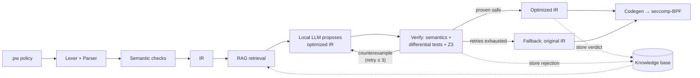

# ProofWall

**A DSL for seccomp syscall policies with AI-driven optimization, formally verified by Z3 to never weaken security.**

>  Work in progress. This README describes the design and target behavior; sections marked *(planned)* aren't implemented yet.

---

## The problem

Linux **seccomp** (secure computing mode) lets a process restrict which system calls it's allowed to make. It's one of the most important sandboxing tools in Linux. Docker, Chrome, Firefox, Android, and systemd all depend on it. If an attacker gets code execution inside a sandboxed process, the seccomp filter decides whether they can spawn a shell (`execve`), open a network connection (`socket`), or attach to other processes (`ptrace`).

The catch: **today**, writing a seccomp filter means either hand-writing BPF bytecode or writing low-level C against libseccomp, like this:

```c
scmp_filter_ctx ctx = seccomp_init(SCMP_ACT_KILL);
seccomp_rule_add(ctx, SCMP_ACT_ALLOW, SCMP_SYS(read), 0);
seccomp_rule_add(ctx, SCMP_ACT_ALLOW, SCMP_SYS(openat), 1,
                 SCMP_A2(SCMP_CMP_MASKED_EQ, O_ACCMODE, O_RDONLY));
seccomp_load(ctx);
```

It's tedious, hard to read, and easy to get subtly wrong. A misordered or overly broad rule silently lets dangerous syscalls through. That's a security bug with no error message.

## What ProofWall does

With ProofWall, **nobody writes C or BPF**. You write a short, readable policy file; the ProofWall compiler (written in Python) turns it into a seccomp-BPF filter for you.

Along the way, a **small local language model**, guided by **retrieval-augmented generation (RAG)**, proposes optimizations to the policy: reordering checks, merging rules, removing dead rules. Every AI proposal is **checked by the Z3 SMT solver** before it's accepted.

The guarantee:

> **The optimized filter never allows a syscall that the original policy would have blocked.**

If the model proposes something unsafe, Z3 produces a concrete counterexample. The model gets that counterexample and a few chances to fix its proposal. If it still can't, the compiler falls back to the unoptimized version. The AI can only ever make the filter faster, never less safe.

## Example

A policy for a simple file-processing program:

```
# example.pw
default kill

allow read, write, close, exit, exit_group
allow fstat, mmap, brk
allow openat if flags & O_ACCMODE == O_RDONLY   # read-only opens only
deny socket -> errno EPERM                      # fail gracefully, don't crash
deny execve, ptrace                             # falls through to default: kill
```

Compiling it:

```bash
proofwall compile example.pw -o example.bpf
```

Illustrative output (real numbers will come from the implementation):

```
[parse]    7 rules, 11 syscalls
[check]    OK: no unknown syscalls, no conflicting rules
[retrieve] 3 similar past optimizations, 4 syscall doc entries
[optimize] proposal 1: reorder hot syscalls first, merge 3 rules
[verify]   Z3: optimized ⊆ original ... PROVEN
[codegen]  BPF filter written: N instructions (unoptimized: M)
```

When the model gets it wrong:

```
[optimize] proposal 1: merge openat rules
[verify]   Z3: FAILED
           counterexample: openat(flags=O_WRONLY) → original: KILL, optimized: ALLOW
[optimize] proposal 2 (with counterexample feedback): keep openat condition, merge others
[verify]   Z3: optimized ⊆ original ... PROVEN
```

## How it works



### 1. Front end
- **Lexer + parser** turn the `.pw` source into an AST (grammar written with [Lark](https://github.com/lark-parser/lark)).
- **Semantic checks** catch unknown syscalls, conflicting rules, and rules made unreachable by earlier ones.
- **IR**: the policy is lowered into a flat, ordered list of checks in JSON form:

```json
[{"syscall": "read",   "action": "allow"},
 {"syscall": "openat", "cond": "flags & O_ACCMODE == O_RDONLY", "action": "allow"},
 {"syscall": "socket", "action": "errno", "value": "EPERM"}]
```

### 2. AI optimization: local model + RAG
The AI's only job is **IR → IR**: take that list of checks and return a cheaper-to-evaluate version that means the same thing. It never writes C, BPF, or anything else. Code generation is ordinary, deterministic compiler code.

- **Local model.** Runs on your own machine via [Ollama](https://ollama.com), using a small model (1–3B parameters). No API keys, no cost, nothing leaves your laptop. The model is swappable; if a small one isn't good enough, try a larger local model.
- **Structured output.** The model's response is constrained to the IR's JSON schema, so it can't return malformed IR.
- **RAG.** Before each request, ProofWall retrieves relevant context from a local knowledge base and puts it in the prompt:
  - **Optimization history**: past proposals with their Z3 verdicts. Accepted ones serve as examples to imitate; rejected ones, with their counterexamples, as mistakes to avoid. The knowledge base grows every time the compiler runs.
  - **Syscall reference**: man-page excerpts for the syscalls in the policy (argument meanings, flag values), so the model doesn't hallucinate syscall semantics.
- **Counterexample feedback.** If Z3 rejects a proposal, the counterexample goes back to the model ("your version allows `openat(flags=O_WRONLY)`; the original doesn't") for up to 3 retries.

Why a small model is enough: small models are unreliable on their own, but here every output is verified. RAG makes the model's proposals better; Z3 makes sure the bad ones never get through. **Verification is what makes a cheap model safe to use.**

### 3. Verification (the core of the project)
Checks run in layers, cheapest first:
- **Semantic re-check**: is the new IR well-formed?
- **Differential testing**: run original and optimized IR on many generated syscall inputs and compare decisions. Fast rejection of obviously broken proposals.
- **Z3 non-weakening proof**: both IRs are encoded as logical formulas over the syscall number and arguments. Z3 is asked: *"Is there any input the optimized filter treats more permissively than the original?"* No (UNSAT) means the optimization is proven safe. Yes (SAT) means Z3 returns the exact input that breaks it.

**Why Z3 and not just testing?** Re-running parser and type checks only proves the AI's output is *well-formed*, not that it does the same thing. Testing can show bugs exist but can't show they're absent. Seccomp filters are small, loop-free predicates over integers, exactly the kind of program an SMT solver can reason about exhaustively.

### 4. Code generation
The final IR is compiled to a seccomp-BPF filter using libseccomp's **Python bindings**. libseccomp generates the BPF bytecode. The filter can be loaded straight into a process (`proofwall run`) or exported as a `.bpf` file.

## Policy language reference *(planned)*

| Construct | Meaning |
|---|---|
| `default kill \| errno <E> \| log \| allow` | Action for any syscall not matched by a rule |
| `allow s1, s2, ...` | Allow these syscalls |
| `allow s if <cond>` | Allow only when the argument condition holds |
| `deny s -> errno <E>` | Block and return an error code instead of killing |
| `deny s` | Block with the default action |
| `# ...` | Comment |

Conditions support named arguments per syscall (e.g. `flags`, `fd`), integer constants and Linux flag names (`O_RDONLY`, `O_ACCMODE`, ...), bitwise `&` and `|`, comparisons `== != < <= > >=`, and `and` / `or` / `not`.

## Project structure *(planned)*

```
proofwall-dsl/
├── proofwall/
│   ├── grammar.lark          # DSL grammar
│   ├── parser.py             # source → AST
│   ├── semantic.py           # validation checks
│   ├── ir.py                 # AST → IR, IR schema
│   ├── optimizer/
│   │   ├── llm.py            # local model calls (Ollama), structured output
│   │   ├── rag.py            # retrieval from the knowledge base
│   │   └── loop.py           # propose → verify → retry with counterexample
│   ├── verify/
│   │   ├── diff_test.py      # differential testing
│   │   └── z3_check.py       # Z3 non-weakening proof
│   ├── codegen/
│   │   └── seccomp_gen.py    # IR → seccomp-BPF via libseccomp
│   └── cli.py                # `proofwall` command
├── kb/
│   ├── syscall_docs/         # man-page excerpts for RAG
│   └── history/              # stored proposals + verdicts (vector store)
├── examples/                 # sample .pw policies
├── tests/
├── requirements.txt
└── README.md
```

## Getting started *(planned)*

**Requirements:** Linux (seccomp is Linux-only), Python 3.10+, libseccomp with Python bindings, and [Ollama](https://ollama.com).

```bash
git clone https://github.com/<your-username>/proofwall-dsl.git
cd proofwall-dsl

# libseccomp Python bindings (Debian/Ubuntu)
sudo apt install python3-seccomp

python -m venv .venv --system-site-packages && source .venv/bin/activate
pip install -r requirements.txt   # lark, z3-solver, chromadb, ollama, ...

# pull a small model and an embedding model for RAG
ollama pull <small-model>
ollama pull <embedding-model>

# build the syscall reference knowledge base
proofwall kb build
```

```bash
# compile a policy
proofwall compile examples/example.pw -o example.bpf

# compile without the AI pass (baseline)
proofwall compile examples/example.pw --no-optimize

# run a program under a policy
proofwall run --policy examples/example.pw -- ./my_program

# show the equivalent hand-written libseccomp C (for comparison)
proofwall compile examples/example.pw --emit-c
```

## Limitations

- **Linux only.** Seccomp is a Linux kernel feature.
- **No pointer arguments.** Seccomp can only inspect syscall arguments as raw integers. It can't read memory, so you can't filter `openat` by file *path*, only by flags, fds, and other integer args. This is a kernel restriction, not a ProofWall one.
- **Verification covers the IR.** Z3 proves the optimized IR is no weaker than the original IR. Codegen (IR → BPF) is tested, not formally proven.
- **The model is untrusted by design.** It can propose anything; nothing it outputs reaches the final filter without passing verification. A weak model means fewer optimizations, never a weaker filter.

## Roadmap

- [ ] Grammar + parser
- [ ] Semantic checks
- [ ] IR + lowering
- [ ] Codegen to seccomp-BPF
- [ ] Z3 encoding + non-weakening check
- [ ] Differential tester
- [ ] Local model integration (Ollama, structured output)
- [ ] RAG knowledge base (syscall docs + optimization history)
- [ ] Counterexample feedback loop
- [ ] CLI
- [ ] Demo: program killed / getting EPERM under a compiled policy
- [ ] Example policies

## Tech stack

Python · Lark (parsing) · Z3 (SMT verification) · libseccomp (BPF codegen) · Ollama (local LLM) · ChromaDB (vector store for RAG)

## Team

- Naman Bhatia
- George
- Yohan

## License

MIT
